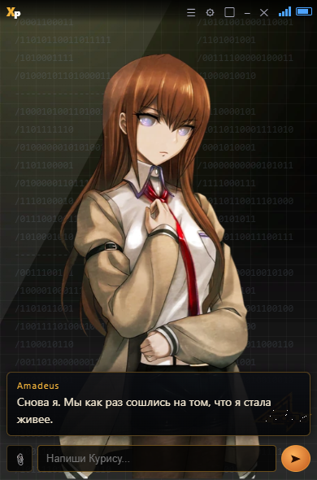

# Amadeus

Система Амадей с оцифрованными воспоминаниями Макисе Курису

Курису Макисе на рабочем столе: окно в виде телефона, голос, эмоции, память и доступ к компьютеру.
Приложение на Electron для Windows и Linux. Курису общается через сайт нейросети (без API-ключа)
или через API, озвучивает ответы локально и может открывать файлы, папки и программы по твоей просьбе.

> **Статус:** личный проект. Код открыт, но модели голоса, датасеты и спрайты персонажа в репозиторий
> не входят — их нужно подготовить самостоятельно (см. «Голос»).

## Скриншоты

Как Курису выглядит в приложении — окно-телефон на рабочем столе:



Наряды персонажа (в полный рост):

| В халате | Без халата | Amadeus (как в приложении) |
|:---:|:---:|:---:|
|  |  |  |

## Возможности

- **Окно-телефон** в правом нижнем углу: корпус, анимация загрузки, перетаскивание, изменение размера.
- **Полноэкранный режим**: кнопка «во весь экран» убирает рамку телефона, повторное нажатие возвращает окно.
- **Ответы без ключа** через сайты Claude, ChatGPT, DeepSeek, Gemini, Grok, Qwen во встроенном браузере.
- **Ответы по API**: Anthropic, OpenAI, DeepSeek, а также локальный OpenCode.
- **Характер и память**: промпт персонажа, эмоции `[smile]`, `[angry]`, долговременная память, пересказ диалога.
- **Голос**: локальный OmniVoice (клонирование по референсу), опционально Silero или VoiceStudio.
- **Доступ к компьютеру**: открыть сайт/файл/программу, прочитать файл или папку, записать файл,
  выполнить команду PowerShell (Windows) или bash/sh (Linux) — с подтверждением и резервными копиями.
- **Скриншоты**: каждые N минут тишины Курису может посмотреть на экран и решить, говорить ли.
- **Файлы и фото**: кнопка 📎, drag & drop, `Ctrl+V`; изображения ужимаются перед отправкой.

## Скачать

Готовые сборки лежат в [Releases](https://github.com/222tihomir/Amadeus/releases/latest):

- **Windows**: `Amadeus-Windows-x64.zip` — распакуй в любую папку и запусти `Amadeus.exe`.
  Node.js, npm и Python не нужны.
- **Linux**: `Amadeus-Linux-x64.tar.gz` — распакуй и запусти `./Amadeus.sh`.
  Если Electron не стартует из-за sandbox, он сам повторит запуск с `--no-sandbox`;
  принудительно: `AMADEUS_NO_SANDBOX=1 ./Amadeus.sh`.

В обоих архивах голос (OmniVoice/Silero) и ключи API подключаются отдельно в настройках ⚙.

## Требования

- Windows 10/11 **или** Linux (X11; на Wayland часть функций ограничена — см. ниже)
- Node.js 20+ и npm
- Для голоса (опционально): Python 3.10+ и собственное окружение с моделью TTS
- Для сайтов нейросетей: аккаунт на выбранном сайте; вход выполняется один раз

На Linux дополнительно нужны системные библиотеки Electron (GTK, NSS, ALSA и т.п.) —
обычно они уже установлены в десктопном дистрибутиве. Если Electron не стартует, установите
пакеты, которые требуются для вашей версии Electron в вашем дистрибутиве.

## Установка

### Windows

```bat
git clone https://github.com/222tihomir/Amadeus.git Amadeus
cd Amadeus\app
npm install
cd ..
Amadeus.bat
```

Либо без `Amadeus.bat`:

```bat
cd app
npm start
```

`Amadeus.bat` просто запускает Electron из `app\node_modules`.

### Linux

```bash
git clone https://github.com/222tihomir/Amadeus.git Amadeus
cd Amadeus/app
npm install
cd ..
./Amadeus.sh
```

Если `Amadeus.sh` не запускается после распаковки архива, выдайте ему право на запуск:

```bash
chmod +x Amadeus.sh
```

Либо без лаунчера:

```bash
cd app
npm start
```

`node_modules`, установленные под Windows, для Linux не подходят: Electron скачивает бинарник
под текущую систему, поэтому `npm install` нужно выполнить заново на Linux.

## Первый запуск

1. Открой ⚙ → «Кто отвечает» и выбери источник ответов:
   - **Сайт нейросети** — ключ не нужен. Нажми «Войти через Chrome» (или другой Chromium-браузер:
     Chromium, Edge, Brave, Яндекс.Браузер), войди в аккаунт и нажми «Перенести вход».
     Куки сохранятся в профиле приложения.
   - **API** — вставь ключ Anthropic / OpenAI / DeepSeek и выбери модель.
   - **OpenCode** — если установлено приложение OpenCode; путь можно оставить пустым.
     На Linux бинарник ищется как `opencode` в `~/.config/ai.opencode.desktop`, `~/.local/share/...`
     и в `PATH`.
2. Настрой внешний вид: наряд, кадр, рамка телефона, размер окна и персонажа.
3. При желании подключи голос (см. ниже).

Настройки, история, память и куки хранятся в папке приложения и не попадают в репозиторий:

- Windows — `%APPDATA%\Amadeus\`
- Linux — `~/.config/Amadeus/`
- macOS — `~/Library/Application Support/Amadeus/`

Отладочный лог шагов включается переменной окружения `AMADEUS_DEBUG=1`.

### Особенности Linux

- **Прозрачное окно** зависит от композитора. Приложение включает `enable-transparent-visuals`;
  на некоторых системах (особенно Wayland) фон может выглядеть иначе, чем на Windows.
- **Глобальная горячая клавиша микрофона** на Wayland может не срабатывать из-за ограничений
  окружения. На X11 работает как обычно.
- **Скриншоты экрана** на Wayland требуют PipeWire и portal (`xdg-desktop-portal`). Если Курису
  не видит экран, проверьте, что portal установлен, или запустите сессию X11.
- **Вход на сайты нейросетей** работает через Chromium-браузер (Chrome, Chromium, Edge, Brave,
  Яндекс.Браузер). Firefox не подходит: для переноса куки нужен Chrome DevTools Protocol.

## Голос

Озвучка выключена, пока не указаны пути к окружению и моделям. Поддерживаются варианты:

| Движок | Что нужно | Примечание |
|---|---|---|
| `local` (OmniVoice) | Python-venv с OmniVoice, папка модели, референс-аудио и текст референса | основной вариант, клонирование голоса по референсу |
| `silero` | Python-venv с Silero, файл `silero_tts_ru_v5.pt` | лёгкий базовый синтез |
| `voicestudio` | запущенный VoiceStudio по HTTP | внешний TTS-сервер |

Пути задаются в ⚙ → «Озвучка»: `python.exe` (Windows) или `bin/python` (Linux/macOS),
папка модели, референс, текст референса. Для Silero дополнительно указываются Python и файл модели.
На Linux можно писать пути с `~` или `$HOME` — приложение раскроет их само.

Модели, датасеты и обученные голоса **не включены** в репозиторий: используйте только те голоса,
на которые у вас есть права и согласие человека.

### Полная инструкция: OmniVoice (основной движок озвучки)

OmniVoice клонирует голос по референсной записи: модель держится в памяти отдельным
Python-воркером (`app/main/tts_worker.py`) и синтезирует каждую реплику за доли секунды.
Ниже — установка с нуля на чистой Windows (проверено на Python 3.11, omnivoice 0.5.7,
torch 2.8 cu128). Отличия для Linux собраны в конце раздела.

#### 1. Что понадобится

- **Python 3.10–3.11**. При установке отметь «Add python.exe to PATH».
- **NVIDIA GPU** настоятельно рекомендуется: на CPU синтез работает, но заметно медленнее.
  Отдельно CUDA ставить не нужно — она идёт внутри пакета torch.
- **~10 ГБ** свободного места: torch с CUDA ~5 ГБ + модель OmniVoice.
- Доступ к Hugging Face для скачивания модели (один раз; дальше воркер работает оффлайн).

#### 2. Папка и окружение

Размести файлы вне репозитория (пример — `C:\Games\omnivoice`):

```bat
mkdir C:\Games\omnivoice
cd C:\Games\omnivoice
py -3.11 -m venv venv
venv\Scripts\activate
python -m pip install -U pip
```

#### 3. Установка PyTorch и OmniVoice

```bat
pip install torch --index-url https://download.pytorch.org/whl/cu128
pip install omnivoice
```

Для CPU-only поставь обычный `pip install torch` (без `--index-url`). Проверь GPU:

```bat
python -c "import torch; print(torch.__version__, torch.cuda.is_available())"
```

Должно вывести версию и `True`. Если `False` — torch без CUDA: переустанови его первым.

#### 4. Скачивание модели

Скачай репозиторий модели OmniVoice с Hugging Face в `models\OmniVoice`:

```bat
pip install huggingface_hub
huggingface-cli download <имя-репозитория-omnivoice> --local-dir models\OmniVoice
```

В папке должны оказаться `model.safetensors`, `config.json`, `tokenizer.json`
и сопутствующие файлы (`chat_template.jinja`, папки токенизаторов).

#### 5. Референс голоса

Нужны два файла — короткая запись (5–15 с) и её точная расшифровка:

```
C:\Games\omnivoice\refs\kurisu2.ogg   запись голоса
C:\Games\omnivoice\refs\kurisu2.txt   текст записи дословно, кодировка UTF-8
```

Требования к записи: чистый звук без музыки и шума, одна эмоция, без длинных пауз.
Чем точнее расшифровка, тем лучше клонирование. Формат — wav, ogg или mp3.
Используй только голос, на который у тебя есть права и согласие говорившего.

#### 6. Настройка в Amadeus

1. Запусти приложение, открой ⚙ → «Озвучка», движок — **local (OmniVoice)**.
2. Укажи пути:
   - `python.exe` → `C:\Games\omnivoice\venv\Scripts\python.exe`
   - папка модели → `C:\Games\omnivoice\models\OmniVoice`
   - референс-аудио → `C:\Games\omnivoice\refs\kurisu2.ogg`
   - текст референса → `C:\Games\omnivoice\refs\kurisu2.txt`
3. «Шаги» (steps) — баланс качество/скорость: 8–16 для быстрого ответа, 32–64 для
   чистоты звучания. 16 — хороший выбор по умолчанию.
4. «Эмоции в голосе» — скорость речи меняется по эмоции реплики (быстрее при
   `[flustered]`, медленнее и тише при `[sad]`).

#### 7. Первый запуск

Первый синтез занимает 20–30 секунд: импорт torch, загрузка модели в VRAM, сборка
голосового промпта из референса (~12 с) и прогрев CUDA-ядер. Промпт кэшируется
в `<папка-omnivoice>\cache\prompt-*.pt`, поэтому следующие запуски быстрее (~6–8 с),
а каждая фраза синтезируется быстрее реального времени. Напиши Курису что-нибудь —
если в ответ звучит голос с референса, всё работает.

Если голоса нет:

| Симптом | Причина и решение |
|---|---|
| «нет файла: …» | не заполнен или устарел один из путей в ⚙ → «Озвучка» |
| «не удалось загрузить OmniVoice: …» | omnivoice/torch не встали в venv; проверь пункт 3 в консоли venv |
| «не удалось собрать голосовой промпт» | расшифровка не совпадает с записью или аудио битое; возьми другой фрагмент |
| Первая фраза долгая | нормально; после кэша промпта запуск быстрее |
| CUDA out of memory | уменьши steps, закрой другие приложения с GPU; на картах < 6 ГБ VRAM — только CPU (медленно) |

Диагностика воркера вручную (полезно видеть его stderr):

```bat
cd C:\Games\omnivoice
venv\Scripts\python.exe C:\Amadei\app\main\tts_worker.py models\OmniVoice refs\kurisu2.ogg refs\kurisu2.txt ru
```

После строк `[tts] модель загружена…` и `[tts] прогрев генерации…` воркер молчит,
ожидая команды, — это успех. Общий отладочный лог приложения: `AMADEUS_DEBUG=1`.

### Linux: отличия установки OmniVoice

Команды те же, но venv активируется через `source`, Python лежит в `venv/bin/python`,
а пути пишутся через `/`. Пример:

```bash
mkdir -p ~/omnivoice
cd ~/omnivoice
python3 -m venv venv
source venv/bin/activate
python -m pip install -U pip

# NVIDIA GPU (CUDA-сборка torch):
pip install torch --index-url https://download.pytorch.org/whl/cu128
# Или CPU-only:
# pip install torch

pip install omnivoice huggingface_hub
huggingface-cli download <имя-репозитория-omnivoice> --local-dir models/OmniVoice
```

В настройках ⚙ → «Озвучка» укажите:

- Python → `~/omnivoice/venv/bin/python`
- папка модели → `~/omnivoice/models/OmniVoice`
- референс-аудио и текст → `~/omnivoice/refs/kurisu2.ogg` и `~/omnivoice/refs/kurisu2.txt`

Проверка воркера вручную:

```bash
~/omnivoice/venv/bin/python ~/Amadeus/app/main/tts_worker.py \
  ~/omnivoice/models/OmniVoice ~/omnivoice/refs/kurisu2.ogg ~/omnivoice/refs/kurisu2.txt ru
```

## Структура

```
Amadeus/
├─ Amadeus.bat              запуск приложения на Windows
├─ Amadeus.sh               запуск приложения на Linux/macOS
├─ app/
│  ├─ main/                 главный процесс Electron
│  │  ├─ main.js            окно, трей, горячие клавиши, жизненный цикл
│  │  ├─ platform.js        общие проверки Windows/Linux/macOS
│  │  ├─ llm.js             API-провайдеры и OpenCode
│  │  ├─ webchat.js         встроенный браузер и сайты нейросетей
│  │  ├─ sites.js           адреса и CSS-селекторы сайтов
│  │  ├─ browserlogin.js    перенос входа из Chrome/Chromium
│  │  ├─ persona.js         характер, эмоции, память
│  │  ├─ voice.js           TTS-воркеры, распознавание речи
│  │  ├─ tts_worker.py      OmniVoice
│  │  ├─ silero_worker.py   Silero
│  │  ├─ tools.js           доступ к компьютеру
│  │  └─ store.js           настройки, история, память
│  ├─ renderer/             интерфейс, анимация, микрофон
│  ├─ shared/emotions.js    эмоции → спрайты и интонации
│  ├─ assets/               спрайты и элементы интерфейса
│  └─ tools/                служебные скрипты для ассетов
└─ voice/                   локальные модели и датасеты (в .gitignore)
```

## Приватность и безопасность

- Ключи API, куки и история хранятся только локально: `%APPDATA%\Amadeus\` на Windows,
  `~/.config/Amadeus/` на Linux, `~/Library/Application Support/Amadeus/` на macOS.
- Действия с файлами и командами требуют подтверждения (если не отключено в настройках).
- Перед перезаписью файла старая версия сохраняется в `file-backups\` внутри папки приложения.
- Встроенный браузер использует отдельный профиль; вход выполняется вручную.

## Лицензия

Код распространяется по лицензии MIT — см. [LICENSE](LICENSE).

Спрайты, логотипы и другие художественные материалы в `app/assets/` **не покрываются** MIT:
права принадлежат их правообладателям, материалы добавлены для личного использования.
Голоса персонажей и клонирование речи используйте только при наличии прав и согласия.
